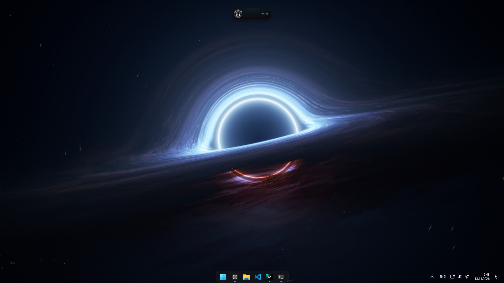
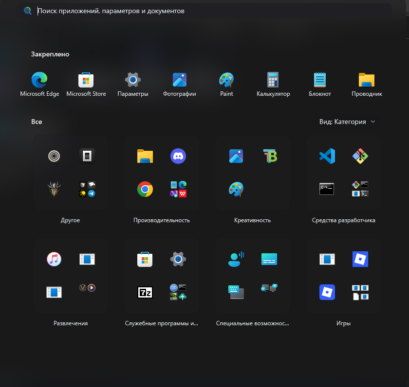
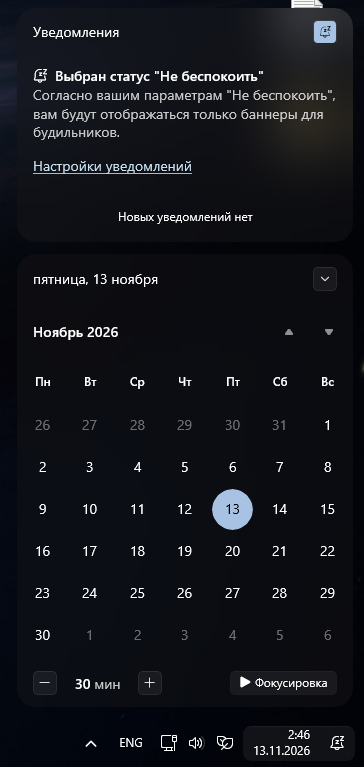
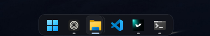
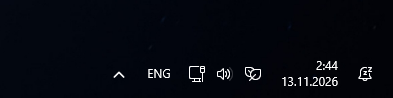

# fln Windows Customization Pack

Готовый пресет кастомизации Windows 11 (24H2+): стеклянный таскбар-док, прозрачное меню «Пуск» и центр уведомлений в стиле **Mocha Glass**, тайлинг-менеджер **komorebi**, пакет обоев и курсоров.

> One-line English: a ready-made Windows 11 rice preset — glassy DockLike taskbar, translucent Mocha Glass Start menu & notification center, komorebi tiling, themed wallpapers & cursors.



## Скриншоты

| | |
|---|---|
|  |  |
|  |  |

*Прозрачные часы и трей:* 

## Что внутри

```
222/
├── explorer.bat                  # fln explorer tweaker (самоповышение + PowerShell)
├── win-tweaker.bat               # fln system tweaker
├── autounattend.xml              # автоматическая установка Windows с пресетом
├── wallpapers/                   # обои по темам: Everforest, Kanagawa, TokyoNight,
│                                 #   NordWin11, Win11GruvboxMaterial, Frieren и др.
├── cursors/                      # пакеты курсоров (dark/light, с Install.inf)
├── presets/                      # готовые настройки Windhawk-модов (.reg)
│   ├── taskbar-styler.reg              # DockLike-док, прозрачные часы, click-through
│   ├── start-menu-styler.reg           # прозрачное «Пуск» (TranslucentStartMenu + правки)
│   ├── notification-center-styler.reg  # Mocha Glass для центра уведомлений
│   └── taskbar-dock-animation.reg      # мягкие прыжки значков (macOS-стиль)
├── komorebi/                     # конфиги тайлинг-менеджера
│   ├── komorebi.json                   # раскладки, рамки Catppuccin Mocha
│   └── whkdrc                          # хоткеи (Alt + H/J/K/L и т.д.)
├── scripts/
│   ├── apply-windhawk-preset.ps1       # применить пресет одной командой
│   └── backup-windhawk.ps1             # бэкап текущих настроек перед применением
└── img/                          # скриншоты
```

## Требования

- Windows 11 **24H2** (build 26100) или новее
- [Windhawk](https://windhawk.net/) — движок модов
- Опционально: [komorebi](https://github.com/LGUG2Z/komorebi) + [whkd](https://github.com/LGUG2Z/whkd) — тайлинг окон
- Тема Windows: **тёмная** (персонализация → цвета)

## Установка

### 1. Windhawk-моды

В Windhawk → «Обзор» установи эти моды (просто установи, настройки перезапишутся пресетом):

| Мод | Автор |
|---|---|
| Windows 11 Taskbar Styler | m417z |
| Windows 11 Start Menu Styler | m417z |
| Windows 11 Notification Center Styler | m417z |
| Taskbar Dock Animation | Ph0en1x-dev |

### 2. Применить пресет — автоматически (рекомендуется)

Запусти `install-all.bat` от имени администратора — он:
1. Установит Windhawk, komorebi и whkd через winget
2. Разложит конфиги komorebi
3. Подскажет, какие 4 мода доустановить в Windhawk (ссылки откроются сами)
4. Импортирует все пресеты и перезапустит оболочку
5. Создаст автозапуск komorebi

Ручной способ:

```powershell
powershell -ExecutionPolicy Bypass -File .\scripts\backup-windhawk.ps1   # бэкап текущих настроек
powershell -ExecutionPolicy Bypass -File .\scripts\apply-windhawk-preset.ps1
```

Скрипт импортирует `.reg`-пресеты и перезапустит проводник с хостами меню/уведомлений.

### 3. Komorebi (опционально)

```powershell
Copy-Item .\komorebi\komorebi.json $env:USERPROFILE\komorebi.json
New-Item -ItemType Directory -Force "$env:USERPROFILE\.config" | Out-Null
Copy-Item .\komorebi\whkdrc $env:USERPROFILE\.config\whkdrc
komorebic start --whkd
```

Автозапуск: ярлык `komorebic-no-console.exe start --whkd` в `shell:startup`.

## Что даёт пресет

- **Таскбар-док**: плавающая центральная панель, стекло с блюром, прозрачные часы, сквозные клики по пустым местам (`clickThroughTaskbar`), кастомная кнопка Пуск, углы 8–12 px
- **Меню «Пуск»**: прозрачный акрил, разделение зон (поиск / закреплено / все / профиль) пустым местом без линий, скругления 12 px
- **Центр уведомлений «Mocha Glass»**: жидкое стекло на всех панелях (блюр 30, тонировка 40%), скругления 18 px, акцент `#89b4fa` (Catppuccin Mocha), скруглённая обложка медиаплеера
- **Анимации дока**: мягкое масштабирование 115% с лёгким прыжком, системные кнопки не анимируются
- **Komorebi**: BSP-тайлинг с рамками Mocha и хоткеями

## Структура настроек

Пресеты лежат в `HKLM\SOFTWARE\Windhawk\Engine\Mods\<id мода>\Settings` — формат `controlStyles[N].target` / `controlStyles[N].styles[N]`, константы в виде `ИМЯ = значение`. Правятся прямо в реестре или через UI мода.

## Лицензия

MIT. Моды Windhawk — их авторы (m417z, Ph0en1x-dev), komorebi — LGUG2Z.
